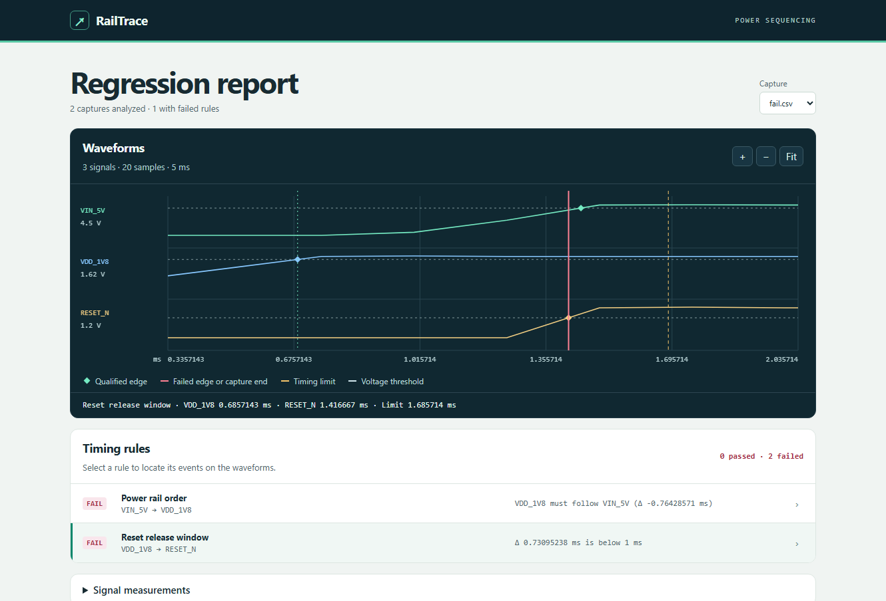

# RailTrace

Run power-sequencing regression tests on CSV waveforms from an oscilloscope or a simulator. RailTrace checks which rails crossed their voltage thresholds first and how long reset took to release. It writes a self-contained HTML report with the measured events and timing limits on a shared time axis.

[简体中文](README.zh-CN.md) · MIT license · Node.js 22+



## Try the examples

Run this from the repository root. RailTrace has no runtime dependencies.

```sh
node bin/railtrace.mjs --config examples/sequence.json --html report.html --json report.json examples/pass.csv examples/fail.csv
```

Open `report.html` in a browser and select **Reset release window**. The failing example releases `RESET_N` about 0.731 ms after `VDD_1V8` crosses 1.62 V. The red line marks the observed release and the dashed amber line marks the earliest allowed release. Use the capture menu to compare it with the passing example.

## Configure a capture

Copy [examples/sequence.json](examples/sequence.json) and edit the column names, thresholds, and timing limits for your board.

| Section | Fields |
| --- | --- |
| `csv` | `timeColumn` names the timestamp header. `timeUnit` is `s`, `ms`, `us`, or `ns`. Optional `delimiter` is a comma (default), semicolon, or tab (`"\t"` in JSON). Optional `skipRows` skips records before the header and `skipDataRows` skips records immediately after it. |
| Each signal | `id` is the name used by rules. `column` names the voltage column. Set `thresholdV` in volts. Optional `edge` is `rising` (default) or `falling`. Optional `holdMs` defaults to 0. Rising detects release of a conventional active-low `RESET_N`. |
| Each rule | `id` labels the rule. `from` is the reference signal and `to` is the measured signal. An `order` rule requires `from` to occur strictly before `to`. A `delay` rule checks `to − from` against inclusive `minMs` and optional `maxMs`. |

CSV inputs use one shared, strictly increasing time column, with at least two samples. Voltage columns use volts and numbers use a decimal point. Quoted fields, scientific notation, extra columns, and UTF-8 with or without a BOM are supported. For separate channel exports, align the channels to a shared time base before importing.

RailTrace linearly interpolates each threshold crossing between samples. The event time is the first crossing that stays on the qualifying side for `holdMs`. A capture that starts on the qualifying side needs a new crossing. A hold that extends past the end of the capture is unconfirmed. Rules with a missing or unconfirmed event fail, and the report marks the end of the capture as the end of the available evidence. Each capture should contain one intended power sequence. The report embeds the configured voltage channels and their full sample data for offline inspection.

## Run in CI

Set the optional `csv.maxSampleGapMs` to the largest allowed interval between adjacent samples, in milliseconds regardless of the CSV time unit. The limit is inclusive. An edge and its full hold must be verified before the first longer gap because an earlier qualifying edge could be hidden in that gap. For example, samples at 0, 1 and 101 ms with a 5 ms hold and `maxSampleGapMs: 5` leave the hold unresolved. The report breaks the waveform at the gap and marks affected rules as `insufficient_evidence`. Choose the limit based on the shortest edge or glitch the capture needs to resolve.

Each invocation uses one configuration for all its input captures. Pass `--json` for structured results and `--html` for an interactive artifact. The report paths are optional and their parent directories must exist.

| Exit code | Meaning |
| --- | --- |
| `0` | Every rule passed in every capture. |
| `1` | At least one rule failed or had insufficient evidence. Requested reports still contain the results. |
| `2` | Invalid arguments, unreadable or malformed input, or a report write error. |

```sh
node --test
```

The repository workflow tests supported Node.js versions on Linux and Windows. The example captures are synthetic fixtures.
