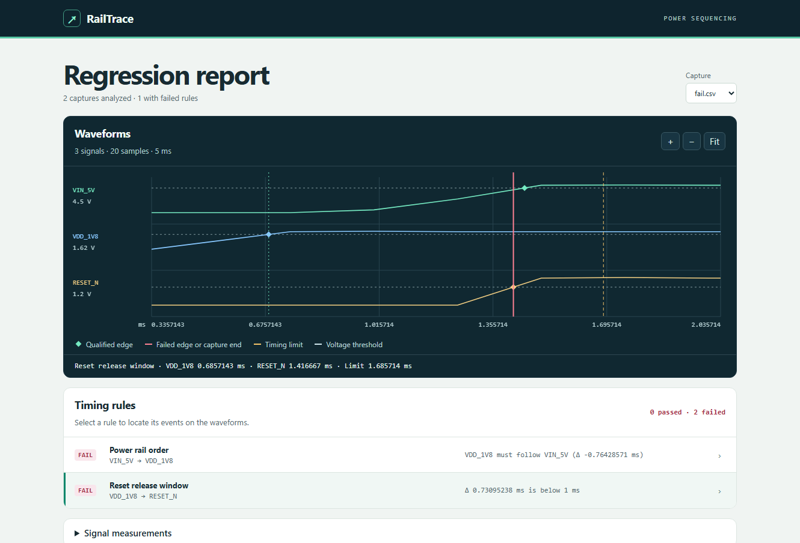

# RailTrace 电源时序回归测试

用示波器或仿真导出的 CSV 检查电源轨上电顺序、复位释放延时。HTML 报告把各通道画在同一时间轴上，选中规则即可定位测量边沿和失败限值。

[English](README.md) · MIT 许可证 · Node.js 22+



## 运行样例

在仓库根目录运行，无需安装第三方依赖。

```sh
node bin/railtrace.mjs --config examples/sequence.json --html report.html --json report.json examples/pass.csv examples/fail.csv
```

用浏览器打开 `report.html`，选择失败样例中的 **Reset release window**。该样例在 `VDD_1V8` 跨过 1.62 V 后约 0.731 ms 释放 `RESET_N`，低于配置的 1 ms 下限。红线标出实际释放时刻，琥珀色虚线标出最早允许释放的时刻。

## 配置你的波形

复制 [examples/sequence.json](examples/sequence.json)，填写实际列名、阈值和时间窗口。

| 配置项 | 含义 |
| --- | --- |
| `csv` | `timeColumn` 对应时间列名，`timeUnit` 支持 `s`、`ms`、`us` 和 `ns`。可用 `delimiter` 指定逗号、分号或制表符，默认逗号。用 `skipRows` 跳过表头之前的记录，用 `skipDataRows` 跳过紧接表头的单位等记录。 |
| `signals` | `id` 是规则引用的信号名，`column` 对应电压列。用 `thresholdV` 指定电压阈值。用 `edge` 指定上升沿 `rising`（默认）或下降沿 `falling`。用 `holdMs` 指定边沿跨过阈值后需保持的毫秒数，默认 0。常见的低有效 `RESET_N` 用上升沿检测释放。 |
| `rules` | `id` 是报告里的规则名。`from` 指定参考信号，`to` 指定目标信号。`order` 要求参考边沿严格早于目标边沿。`delay` 要求两者的时间差落在 `minMs` 与可选的 `maxMs` 之间，包含边界。 |

CSV 需使用共同且严格递增的时间列，至少包含两个采样点。电压列单位为 V，数字使用小数点，支持科学计数法、带引号字段、额外列和 UTF-8 BOM。分别导出的示波器通道需要先对齐至同一时间基准。

工具使用相邻采样点做线性插值，记录首个满足保持时间的阈值交叉。若波形开始时已在阈值的有效侧，工具等待新的交叉。若采样在保持时间满足前结束，相关规则判为缺少有效边沿，报告标出采集结束的位置。每份 CSV 对应一次待检查的时序。离线 HTML 报告内嵌已配置的通道采样。

## 接入回归流程

可在 `csv.maxSampleGapMs` 配置相邻采样点的最大间隔，单位始终是毫秒，等于上限的间隔仍可用。首个更大的缺口可能藏有更早的有效边沿，所以边沿和完整保持时间都需要在该缺口前得到确认。例如，采样时刻为 0、1、101 ms，保持时间为 5 ms，且最大间隔设为 5 ms 时，相关规则为「证据不足」。HTML 波形在缺口断线，JSON 记录 `insufficient_evidence` 及缺口位置。

一个命令可为多份 CSV 应用同一套规则。按需用 `--json` 导出结构化结果，或用 `--html` 保存可交互报告。

| 退出码 | 含义 |
| --- | --- |
| `0` | 所有采集的全部规则通过。 |
| `1` | 至少一条规则失败或证据不足，仍生成请求的报告。 |
| `2` | 参数、配置、CSV 或报告写入错误。 |

运行 `node --test` 执行自动化测试。仓库附带 GitHub Actions 工作流和合成波形样例。
